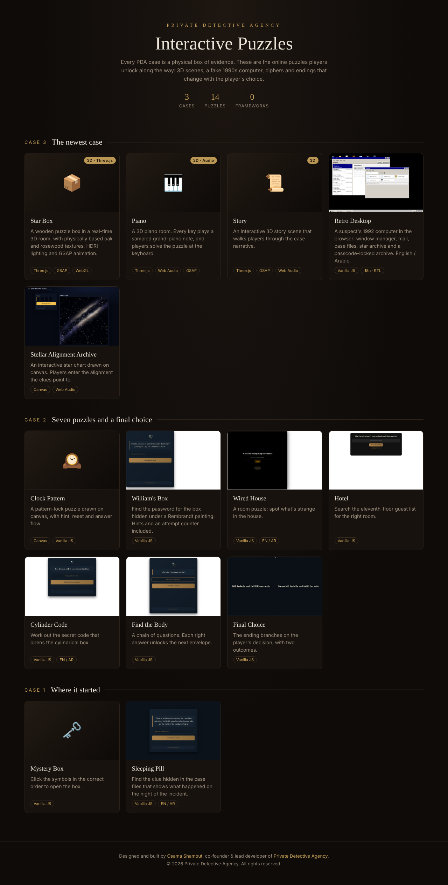
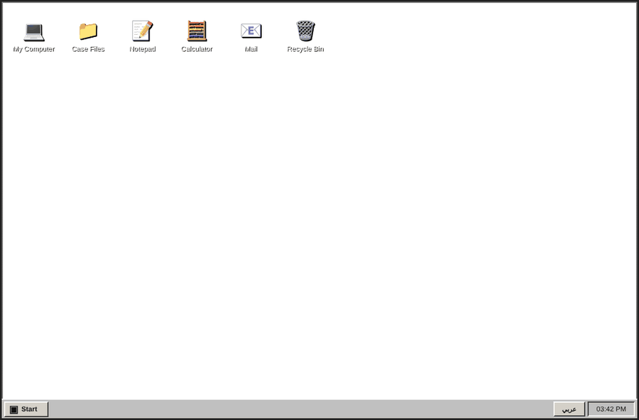
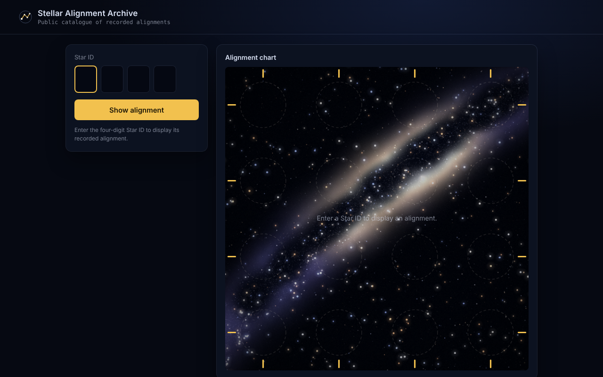
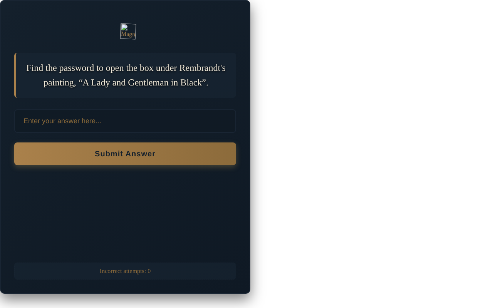
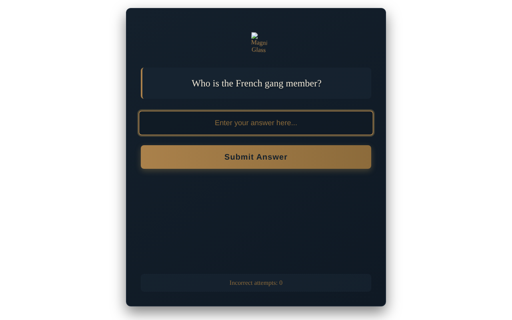
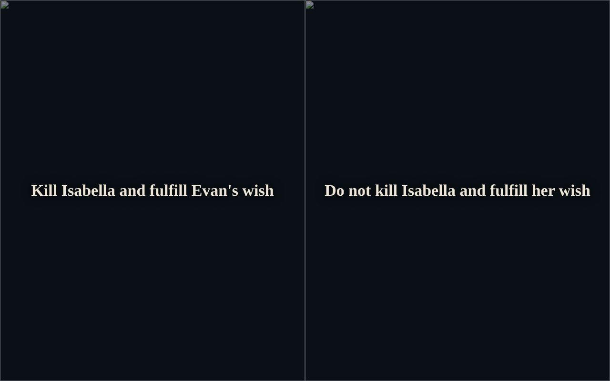

<div align="center">

# 🕵️ PDA Interactive Puzzles

**Every online puzzle from the [Private Detective Agency](https://pdacases.com) detective game cases, collected in one repository.**

Each PDA case is a physical box of evidence. As players investigate, they unlock browser puzzles: 3D scenes, a fake 1990s computer, ciphers and endings that change with their choices.

[](https://pdacases.com)




</div>

---

## 🧩 All puzzles

Open **`index.html`** in the repo root to see every puzzle on one page, grouped by case.

### Case 3: the newest case

| | Puzzle | What it is | Built with |
|---|---|---|---|
| 📦 | **[Star Box](puzzles/case-3/star-box)** | A wooden puzzle box in a real-time 3D room, with PBR oak and rosewood textures and HDRI lighting | Three.js, GSAP, WebGL |
| 🎹 | **[Piano](puzzles/case-3/piano)** | A 3D piano room where every key plays a sampled grand-piano note | Three.js, Web Audio, GSAP |
| 📜 | **[Story](puzzles/case-3/story)** | An interactive 3D story scene that carries the case narrative | Three.js, GSAP, Web Audio |
| 💻 | **[Retro Desktop](puzzles/case-3/retro-desktop)** | A suspect's 1992 computer: window manager, mail, case files, star archive and a locked archive | Vanilla JS, i18n / RTL |
| 🔭 | **[Stellar Alignment Archive](puzzles/case-3/stars)** | An interactive star chart drawn on canvas | Canvas, Web Audio |

<p align="center">
  
  
</p>

### Case 2: seven puzzles and a final choice

| | Puzzle | What it is |
|---|---|---|
| 🕰️ | **[Clock Pattern](puzzles/case-2/clock-pattern)** | A pattern-lock puzzle on canvas, with hint, reset and answer flow |
| 🖼️ | **[William's Box](puzzles/case-2/william-box)** | Find the password for the box hidden under a Rembrandt painting |
| 🏚️ | **[Wired House](puzzles/case-2/wired-house)** | A room puzzle: spot what's strange in the house |
| 🏨 | **[Hotel](puzzles/case-2/hotel)** | Find the right room in the eleventh-floor guest list |
| 🔐 | **[Cylinder Code](puzzles/case-2/password)** | Work out the code that opens the cylindrical box |
| ✉️ | **[Find the Body](puzzles/case-2/find-the-body)** | A chain of questions where each answer unlocks the next envelope |
| ⚖️ | **[Final Choice](puzzles/case-2/final-choice)** | A branching ending with two outcomes |

<p align="center">
  
  
  
</p>

### Case 1: where it started

| | Puzzle | What it is |
|---|---|---|
| 🗝️ | **[Mystery Box](puzzles/case-1/mystery-box)** | Click the symbols in the correct order to open the box |
| 💊 | **[Sleeping Pill](puzzles/case-1/sleeping-pill)** | Find the clue hidden in the case files |

---

## ⚙️ Engineering highlights

- **Real-time 3D in the browser.** The Case 3 scenes use Three.js with physically based materials (color, normal and roughness maps), HDRI environment lighting and GSAP-driven animation. If the textures fail to load, the code draws fallback wood procedurally.
- **Sampled audio.** The piano plays recorded grand-piano notes through the Web Audio API.
- **A full window manager in vanilla JS.** The retro desktop has draggable, focusable, minimizable windows and a live taskbar in about 1,200 lines, with no framework.
- **Bilingual by design.** Puzzles switch between English and Arabic, with right-to-left layout.
- **Built for the real product.** Every puzzle is a self-contained static page that embeds straight into the WordPress store and works on phones (orientation prompts, touch input, vibration feedback).
- **Player-friendly checks.** Answer puzzles have hints, attempt counters and tolerant answer matching.

## 📁 Structure

```
├── index.html              ← gallery: every puzzle on one page
├── puzzles/
│   ├── case-1/  mystery-box · sleeping-pill
│   ├── case-2/  clock-pattern · william-box · wired-house · hotel · password · find-the-body · final-choice
│   └── case-3/  star-box · piano · story · retro-desktop · stars
└── docs/                   ← screenshots and GIFs
```

Adding a new puzzle means adding one folder under `puzzles/case-N/` and one card in `index.html`.

## 🚀 Run locally

The 3D puzzles load textures and ES modules, so serve the folder instead of double-clicking the files:

```bash
git clone https://github.com/Osama-Shamout/pda-retro-desktop.git
cd pda-retro-desktop
python -m http.server 8000      # or: npx serve
# open http://localhost:8000
```

## 🙏 Credits

- 3D textures and HDRI lighting: [Poly Haven](https://polyhaven.com), CC0
- Piano samples: *Salamander Grand Piano* by Alexander Holm, [CC BY 3.0](https://creativecommons.org/licenses/by/3.0/), as distributed by [Tone.js](https://tonejs.github.io/audio/salamander/)
- The full credits sit next to the assets, in each puzzle's `assets/CREDITS.txt`

## 👤 Author

**Osama Shamout**: co-founder and lead developer, Private Detective Agency
[GitHub](https://github.com/Osama-Shamout) · [osama.shamout.it@gmail.com](mailto:osama.shamout.it@gmail.com)

## 📄 License

© 2026 Private Detective Agency (PDA). All rights reserved, except for the third-party assets credited above, which keep their own licenses.
This code is published so it can be viewed as part of a portfolio. The puzzles, story, characters and artwork belong to Private Detective Agency. Copying, redistributing or reusing them commercially requires written permission.
