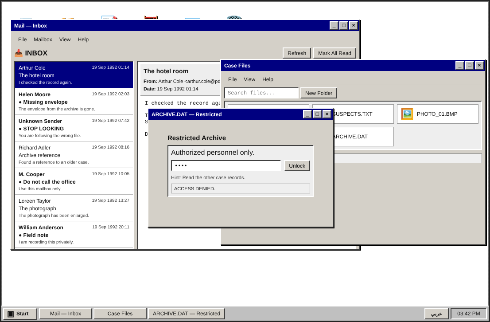
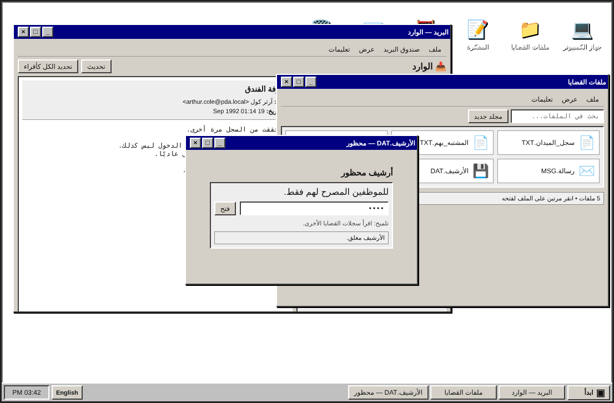

<div align="center">

# 🕵️ PDA Interactive Puzzles

**The browser-based puzzles behind [Private Detective Agency](https://pdacases.com) detective game cases.**

Each case box comes with online puzzles that players must solve to move the investigation forward.

[](https://pdacases.com)


</div>

---

## 🧩 The puzzles

| Puzzle | What the player does | Status |
|---|---|---|
| **[Retro Desktop](puzzles/retro-desktop)** | Logs in to a suspect's 1992 computer, reads the mail, digs through case files and cracks the passcode on a locked archive | ✅ Code in this repo |
| **[Story](https://pdacases.com/story-case-3/)** | Interactive story chapter for Case 3 | 🌐 Live · code coming |
| **[Piano](https://pdacases.com/piano-puzzle-case-3/)** | On-screen piano puzzle for Case 3 | 🌐 Live · code coming |
| **[Star Box](https://pdacases.com/star-box-case-3/)** | Star-box puzzle for Case 3 | 🌐 Live · code coming |

New puzzles are added here as each case ships.

---

## 💻 Retro Desktop

A 1990s operating system recreated in the browser: windows, a taskbar, a start menu and built-in apps. Every app hides a piece of the investigation.

<table>
<tr>
<td width="50%"></td>
<td width="50%"></td>
</tr>
<tr>
<td align="center"><sub>English</sub></td>
<td align="center"><sub>العربية: the whole UI switches at runtime, right to left</sub></td>
</tr>
</table>

**Features**

- **Window manager:** open, focus, drag, minimize, maximize and close any number of windows, with z-index stacking and a live taskbar
- **Built-in apps:** Mail client (inbox and reader), Case Files with search, My Computer, Notepad, Calculator and Recycle Bin
- **Puzzle mechanics:** a passcode-locked archive, with clues spread across emails, files and deleted items
- **Bilingual:** English / Arabic toggle driven by one i18n dictionary, with full RTL layout
- **Safe rendering:** every user-facing string passes through an HTML-escape helper before it reaches the DOM

**How it's built**

```
puzzles/retro-desktop/
├── index.html   desktop shell: icons, start menu, taskbar
├── script.js    window manager, apps, i18n, puzzle state (~1,000 lines)
└── style.css    retro theme: bevels, pixel borders, system fonts
```

- `makeWindow()` builds each window from a template. `focusWindow()`, `minimizeWindow()` and `toggleMax()` manage its state, and `makeDraggable()` moves it with pointer events.
- Each app (`openMail`, `openCases`, `openArchive`, …) is a self-contained function that renders its window and binds its own events.
- `setLanguage()` swaps the language and re-renders every window that's open, without reloading the page.

---

## 🚀 Run locally

No install and no build step.

```bash
git clone https://github.com/Osama-Shamout/pda-retro-desktop.git
cd pda-retro-desktop
# open puzzles/retro-desktop/index.html in any modern browser
```

## 🛠 Tech

Plain **HTML5, CSS3 and JavaScript (ES6+)** with no frameworks, libraries or backend. Every puzzle is a static page, so it can be embedded in the store or hosted anywhere.

## 👤 Author

**Osama Shamout**: co-founder and lead developer, Private Detective Agency
[GitHub](https://github.com/Osama-Shamout) · [osama.shamout.it@gmail.com](mailto:osama.shamout.it@gmail.com)

## 📄 License

© 2026 Private Detective Agency (PDA). All rights reserved.
This code is published so it can be viewed as part of a portfolio. The puzzles, story, characters and assets belong to Private Detective Agency. Copying, redistributing or reusing them commercially requires written permission.
